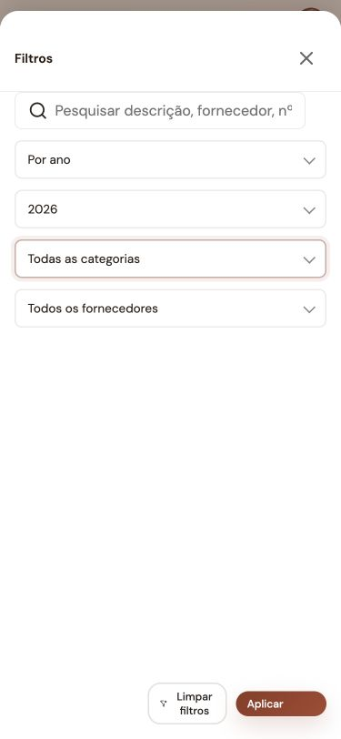

# Correções da auditoria mobile — 23 de outubro de 2026

As 13 ocorrências M01–M13 do RELATORIO.md receberam correções no código local. As alterações existentes no projeto foram preservadas. Não foi efetuado deploy.

| Ocorrência | Correção |
|---|---|
| M01 | Removidos os contextos de empilhamento de `.layout` e `.content` que deixavam filtros sob a navegação. Folhas partilham gestão de foco, Escape, fundo inerte, bloqueio de scroll e limpeza na navegação/resize. Folhas fechadas deixam de expor controlos ao teclado. |
| M02 | Filtros de despesas em coluna sem crescimento da pesquisa; seletores ocupam a largura disponível; rodapé acessível com margem de segurança. |
| M03 | O separador Preços carrega código e HTML antes de montar o calendário, com estado de carregamento, repetição em caso de falha e proteção contra troca de separador durante o pedido. |
| M04 | Os separadores de alojamento passam a ter scroll horizontal próprio. A área principal mantém a largura e a posição horizontal. |
| M05 | A edição de reserva compara o formulário com o estado inicial. Cancelar/Escape pedem confirmação se existirem alterações; recarregar/sair da página ativa a proteção do navegador. Reservas novas mantêm o rascunho existente. |
| M06 | Vistas ainda sem HTML apresentam uma indicação de carregamento e `aria-busy` durante o pedido. |
| M07 | Menu mobile inclui Mensagens e Vouchers; Modelos de email identifica a opção de configuração. |
| M08 | Calendário/Eventos mantêm o menu superior em paisagem. O botão abre o drawer mobile também em ecrãs largos de pouca altura. |
| M09 | Navegação inferior e botão de nova reserva ficam ocultos antes da autenticação. |
| M10 | Botões de despesas, alojamentos e navegação dos preços têm altura mínima de 44 px nos layouts mobile; campos de alojamentos usam 16 px. Ações de despesas e botão de nova reserva têm nomes acessíveis. |
| M11 | Eventos apresentam erro junto ao campo, foco e `aria-invalid`. Labels dos formulários foram associados aos controlos. Corrigida também a atribuição de datas ISO ao campo nativo de evento. |
| M12 | Durações principais centralizadas em tokens; movimento reduzido abrange folhas, scrims, atrasos e animações decorativas da reserva pública. |
| M13 | O calendário customizado fica limitado ao viewport visual, reposiciona após animações/alterações do viewport e consome Escape sem fechar o editor. Abrir um diálogo já não abre automaticamente o seletor de datas. |

## Validação

- `check-source.cjs`: sintaxe, recursos HTML, módulos e ações registadas válidos.
- `check-browser.cjs`: bateria geral passou. Corrigido o seletor ambíguo do botão de pagamento online, limitando-o ao elemento visível.
- `check-mobile-ux.cjs`: passou em Chromium e WebKit. Cobre login, primeiro carregamento de preços, overflow, carregamento lento de HTML, filtros a 320/375/600 px, restauração de foco, resize, menu e paisagem, validação/data de eventos, edição alterada e intacta, calendário customizado e movimento reduzido.
- `check-calendar-mobile.cjs`: passou — seleção, contagens, detalhe, dias vazios, navegação e layouts.
- `check-public-mobile.cjs`: passou em Chromium — navegação, dados preservados, submissão sintética com dois hóspedes e comparação desktop.
- Verificação interativa: preços carregados na primeira visita; largura principal 375/375 px e scroll horizontal zero; pesquisa de despesas com 41 px de altura; rodapé termina a 796 px num viewport de 812 px e recebe os toques acima da navegação.

A nova regressão pode ser executada com `npm run test:mobile` em `backend/src`. Usa uma base descartável, sem ler `.env` ou dados de clientes. WebKit: definir `BROWSER_ENGINE=webkit` e ter o motor Playwright instalado.

## Limites

A simulação não substitui um ensaio em iPhone/Android físicos, incluindo teclado virtual, áreas seguras e zoom de texto. As observações editoriais/estéticas adicionais do relatório (formatos monetários, nomenclatura e redesign global de cartões) não fazem parte das 13 falhas corrigidas e não foram objeto de uma reformulação completa.

## Evidência visual

